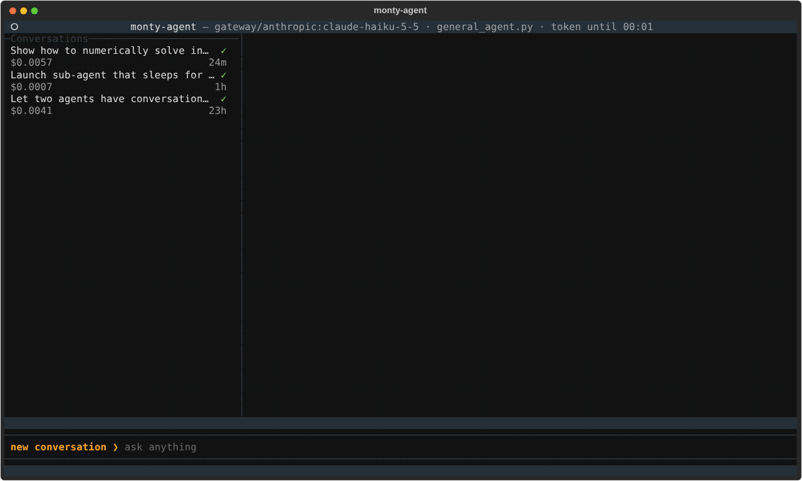

# monty-agent

An agent that lives in a sandbox. The agent loop, its tools and sub-agents run inside
[Monty](https://github.com/pydantic/monty); every model request, file and environment read is a call out that the
host answers. A paused sandbox is a checkpoint, so any step of a conversation can be answered again, rolled back or
forked.

<p align="center">
  
  <br>
  <em>Ask, answer, roll back to the question, fork the last step. Code runs and earlier steps are reused.</em>
  (<a href="https://github.com/jirikuncar/monty-agent/blob/main/docs/assets/demo.mp4">mp4</a>,
  <a href="https://github.com/jirikuncar/monty-agent/blob/main/docs/assets/demo.py">source</a>)
</p>

> **Prototype.** Built on a minimal Pydantic AI subset that runs in Monty; APIs change without notice.

## Try it

```sh
uvx --python 3.15 --from 'monty-agent[tui] @ git+https://github.com/jirikuncar/monty-agent' monty-agent
```

The TUI logs in to Logfire with OAuth (device flow) and runs every turn in Logfire Agent Sandboxes, with model
requests through the AI Gateway. Nothing is stored locally: each step is a Logfire record, and the conversation list
is a query.

It uses the US region by default. Pass `--remote` for another one, or for a self-hosted Logfire with Agent Sandboxes;
`--gateway` names its AI Gateway (without one, use a model the host has keys for):

```sh
monty-agent --remote https://logfire-eu.pydantic.dev/
monty-agent --remote https://logfire.example.com/ --gateway https://gateway.example.com
monty-agent --remote https://logfire.example.com/ --model openai:gpt-5.2   # OPENAI_API_KEY on the host
```

## What runs where

| In the sandbox                                       | On the host                                      |
| ---------------------------------------------------- | ------------------------------------------------ |
| agent loop, tools, sub-agents, message history       | model requests (`host.model_request`)            |
| model-written code, in a fresh child sandbox         | `/workspace` files, allowlisted env vars         |
| `host.ask_user(question)` suspends the turn          | the user's answer, possibly hours later          |

API keys never enter the sandbox. Code the model writes (`run_code` in
[`examples/general_agent.py`](examples/general_agent.py)) runs in a child sandbox with no mounts, env or host
functions, and tighter limits; errors go back to the model.

## Checkpoints, rollback, fork

Before every model request the sandbox pauses and its state is stored: the Monty snapshot (agent, tools, sub-agent
stack, history, paused call stack) plus the in-memory workspace. Every step in the transcript is one of these.

| You pick              | What runs again                         | What is reused                                    |
| --------------------- | --------------------------------------- | ------------------------------------------------- |
| a question, answer it | the turn from the answer on             | everything before the question; no model request is re-issued |
| a model step, Enter   | that model request and what follows it  | earlier requests, code runs and workspace writes  |
| a model step + model  | the same, with another model            | the same                                          |
| a result, reply       | a new turn in the restored session      | the whole conversation                            |

Branches never share state: each one restores into a fresh sandbox. In the demo, the fork re-runs one model request
($0.0014) instead of the turn ($0.0057), and its two code runs are not repeated. Real side effects (HTTP, databases)
do run again, so make such tools idempotent.

## Keys

| Key            | Does                                                                     |
| -------------- | ------------------------------------------------------------------------ |
| click / Enter  | fork from that entry: answer, edit a prompt, re-run a step               |
| ← / →          | in the sidebar: the other branches from the same fork point              |
| ctrl+t         | code runs of every branch; Enter opens the branch at that run            |
| ctrl+o         | expand model steps: which agent, tool results in, reply out              |
| ctrl+g         | retry the last failed request                                            |
| ctrl+p         | commands, branches; text that matches none runs as a prompt              |
| option-click   | open the span in Logfire                                                 |

## Without the TUI

`host.py` runs any agent script locally in `AsyncMonty`, or with `--remote` in Agent Sandboxes:

```sh
uv run host.py examples/notes_agent.py "summarize my notes" --workspace ./notes --workspace-mode memory \
  --checkpoints run --suspend-at 2                                     # stop before the 2nd model request
uv run host.py --resume run/0001.monty --workspace-mode memory        # roll back to it
uv run host.py --resume run/0000.monty --workspace-mode memory --model ollama:qwen3.5:latest  # fork step 1
uv run pytest
```

`--model test` (the default) needs no key. `--workspace-mode memory` saves files with each checkpoint, so a restore
brings them back; `read-write` writes to disk and `overlay` drops writes after each turn.

## The Pydantic AI subset

`sandbox/pydantic_ai_lite.py` provides `Agent` (`instructions`, `output_type`, `retries`), `@agent.tool` and
`@agent.tool_plain`, `run` and `run_sync`, and the message types. `dump_messages`/`load_messages` match
`ModelMessagesTypeAdapter`, so histories move to and from real Pydantic AI.

Monty shapes it: functions have no `__name__` or `__doc__` (tool names come from `repr`, descriptions from
`description=`), there is no class inheritance (any tool exception is a retry), parameter defaults are not
introspectable (only `X | None` is optional), and output validation is shallow.

## Caveats

- A checkpoint holds compiled code: editing the agent script does not change a restored session.
- Restore only checkpoints you produced; Monty does not authenticate them.
- Open work is in [TODO.md](TODO.md).
